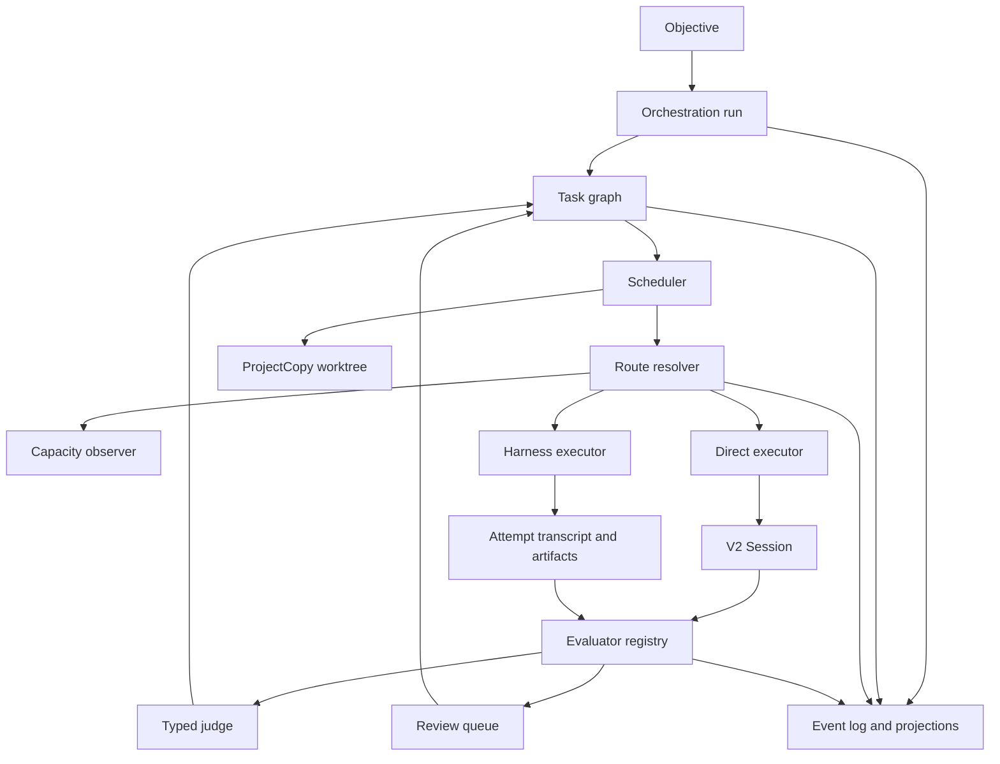

# Architecture

## Current foundation

OpenCode already provides most of the execution substrate JewelCode needs:

- `packages/schema` defines shared data contracts.
- `packages/core` contains durable V2 sessions, event replay, model execution, tools, configuration, and project copies.
- `packages/protocol` defines the public service boundary.
- `packages/opencode` hosts server implementations and the compatibility application.
- `packages/client` contains generated clients.
- `packages/app` contains the Solid application.

V2 Sessions persist conversations and serialize model turns. `ProjectCopy` creates and registers isolated project directories, including Git worktrees. The event store can support durable orchestration projections. These pieces should be composed rather than replaced.

The legacy task tool is useful compatibility behavior, but it is not a durable orchestration base. Its background jobs are process-local, its child sessions share the current location, and the main application still reaches parts of the legacy prompt path.

## Target components

### Orchestration run

The run is the durable aggregate for an objective. It owns task ordering, dependency transitions, attempts, route decisions, evaluation outcomes, suspension, and review state.

### Task graph

Tasks describe units of work and their dependencies. Tasks do not replace Sessions. Each attempt points to the Session or harness execution that performed it.

### Scheduler

The first scheduler can be process-global and local to one host. It selects ready tasks, observes concurrency limits, creates worktrees, resolves routes, and starts attempts. The event log remains authoritative so a later clustered scheduler can adopt the same domain model.

### Route resolver

The resolver receives a bounded route profile and current capacity snapshot. It chooses the first eligible candidate deterministically. It may use a typed classifier to select a profile, but a judge does not own provider credentials, capacity policy, or execution.

### Executors

A direct executor makes the existing single provider stream call within a V2 Session. A harness executor launches an external coding harness such as Claude Code, Codex, Cursor Agent, or Copilot CLI. Harnesses own their internal model loop, tools, and session behavior, so their execution records must remain distinct from direct model calls.

### Evaluators and typed judges

Evaluators run exact checks in the attempt worktree. A typed judge handles questions that are genuinely probabilistic, such as rubric scoring, ambiguity classification, or choosing among a controller-supplied set of legal options.

### Capacity observer

Capacity is a host-level observation with a short cache lifetime. The initial adapter can consume UsagePool's snapshot output. Route resolution reads the latest snapshot and never blocks a prompt while spawning a fresh probe.

## Primary flow

1. Admit an objective and create a durable run.
2. Add tasks and dependencies to the run.
3. Select ready tasks within configured concurrency limits.
4. Create one project copy and one attempt record per selected task.
5. Resolve an eligible route from policy and cached capacity.
6. Execute through a V2 Session or an external harness.
7. Run deterministic checks and store their exact evidence.
8. Use typed judgment only where deterministic evidence is insufficient.
9. Mark the task complete, retry it, escalate it, suspend it until capacity resets, or request human review.
10. Present the resulting changes for explicit acceptance or rejection.

## Invariants

- Durable prompt admission remains separate from model execution.
- A direct provider turn makes one explicit `llm.stream(request)` call.
- A route is pinned for a provider turn or harness attempt. Automatic mid-attempt failover is unsafe after side effects.
- Session history records execution conversation. Task state records orchestration progress.
- New user input continues to follow V2 steer and queue semantics.
- Unknown frontier capacity is ineligible by default unless policy explicitly permits unknown capacity.
- A suspended run stores `retry_at`; no worker sleeps for hours while holding ownership.
- Candidate sets, thresholds, capacity observations, and route reasons are persisted with each routing decision.
- Worktree isolation does not grant permission to execute untrusted commands.

## Package placement

- `packages/schema/src/orchestration`: events, identifiers, states, policies, decisions, and evaluation schemas
- `packages/core/src/orchestration`: aggregate logic, projections, scheduler, routing, capacity, executors, and evaluators
- `packages/protocol`: public orchestration API groups
- `packages/opencode`: HTTP handlers, layers, local process adapters, and compatibility integration
- `packages/client`: generated clients after Protocol or Server API changes
- `packages/app`: mission-control views and operator actions

This preserves the repository's dependency direction. Client runtime code consumes Schema and Protocol contracts without importing Core or Server implementation details.
