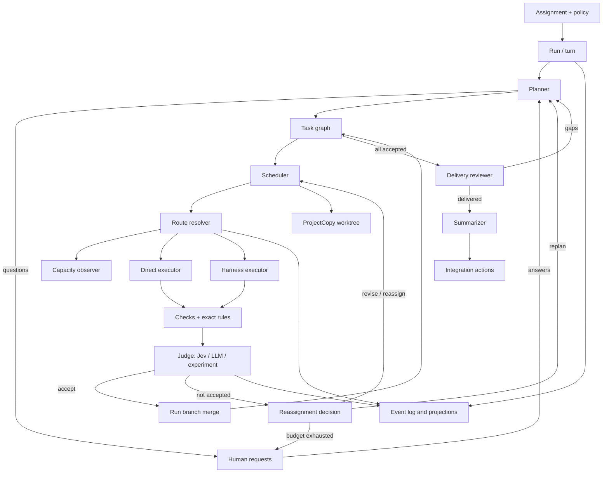

# Architecture

## Current foundation

OpenCode already provides most of the execution substrate JewelCode needs:

- `packages/schema` defines shared data contracts.
- `packages/core` contains durable V2 sessions, event replay, model execution, tools, configuration, and project copies.
- `packages/protocol` defines the public service boundary.
- `packages/opencode` hosts server implementations and the compatibility application.
- `packages/client` contains generated clients.
- `packages/app` contains the Solid application.

V2 Sessions persist conversations and serialize model turns. `ProjectCopy` creates and registers isolated project directories, including Git worktrees. The event store supports durable orchestration projections. These pieces should be composed rather than replaced.

The legacy task tool is useful compatibility behavior, but it is not a durable orchestration base. Its background jobs are process-local, its child sessions share the current location, and the main application still reaches parts of the legacy prompt path.

## Target components

The detailed resource, capability-tier, provider, and telemetry design is in [Capability routing, resources, and execution evidence](./routing-telemetry.md). The autonomous loop is described in [orchestration](./orchestration.md), [evaluation](./evaluation.md), [typed judgment](./jev.md), [planning](./planning.md), and [delivery](./delivery.md).

### Run and turn

The run is the durable aggregate for an assignment thread. It owns turns, task ordering, attempts, route and reassignment decisions, judgments, human requests, the run branch, suspension, deliveries, and integrations. The App shows it through a root `orchestration` Session. Attempt Sessions are that Session's children. See [run sessions](./orchestration.md#run-sessions).

### Planner

A route-selected direct model that returns typed questions or a typed task graph, and replans on request. It cannot define commands, candidates, or policy.

### Scheduler

The first scheduler is process-global and local to one host. It selects ready tasks, observes concurrency limits, creates worktrees from the run branch or the previous attempt, resolves routes, and starts attempts. The event log remains authoritative so a later clustered scheduler can adopt the same domain model.

### Route resolver

The resolver receives a bounded route profile, a requested tier, and the current capacity snapshot. It chooses the first eligible candidate deterministically. A judge can recommend a tier or a reassignment option, but it does not own provider credentials, capacity policy, or execution.

### Executors

A direct executor makes the existing single provider stream call within a V2 Session. A harness executor launches an external coding harness such as Claude Code, Codex, Cursor Agent, or Copilot CLI. Harnesses own their internal model loop, tools, and session behavior, so their execution records remain distinct from direct model calls. Either kind can raise a human request.

### Evaluators and judges

Evaluators run exact checks in the attempt worktree. A typed judge, which is Jev or an LLM behind the same contract, decides acceptance within deterministic gates. The same boundary serves the reassignment decider, the delivery reviewer, and the tier classifier.

### Run branch integrator

The integrator commits attempt worktrees to attempt branches and merges accepted attempts into the run branch in a controller-owned integration worktree. It turns conflicts into rebase attempts.

### Human request inbox

Durable questions, human steps, approvals, and budget decisions. Each request blocks only the work that depends on it.

### Integration service

Executes the user-selected commit, merge, push, and pull request actions against the source repository, with a preflight and recorded steps.

### Capacity observer

Capacity is a host-level observation with a short cache lifetime. The adapter consumes UsagePool's snapshot output and local host readings. Route resolution reads the latest snapshot and never blocks a prompt while spawning a fresh probe.

## Invariants

- Durable prompt admission remains separate from model execution.
- A direct provider turn makes one explicit `llm.stream(request)` call.
- A route is pinned for a provider turn or harness attempt. Automatic mid-attempt failover is unsafe after side effects. Revisions and reassignments are new attempts.
- Session history records execution conversation. Task state records orchestration progress.
- New user input continues to follow V2 steer and queue semantics.
- No judge can accept an attempt with a new check regression or a failed exact rule.
- Every autonomous loop is bounded by recorded budgets. Exhaustion becomes a human request.
- Nothing outside the run's own branches changes without an explicit integration action.
- Unknown frontier capacity is ineligible by default unless policy explicitly permits it.
- A suspended run stores `retry_at`. No worker sleeps for hours while holding ownership.
- Candidate sets, thresholds, capacity observations, judge arms, and decision reasons are persisted with each decision.
- Worktree isolation does not grant permission to execute untrusted commands.

## Package placement

- `packages/schema/src/orchestration`: events, identifiers, states, policies, verdicts, requests, deliveries, and evaluation schemas
- `packages/core/src/orchestration`: aggregate logic, projections, planner, scheduler, routing, capacity, executors, evaluators, judges, run-branch integration, and Git integration actions
- `packages/protocol`: public orchestration API groups
- `packages/server`: HTTP handlers
- `packages/opencode`: layers, local process adapters, and compatibility integration
- `packages/client`: generated clients after Protocol or Server API changes
- `packages/app` and `packages/session-ui`: orchestration timeline renderers, docks, the Run side-panel tab, the integration dialog, the Orchestration settings group, and the Lab page, all on v2 components. See [UI](./ui.md).

This preserves the repository's dependency direction. Client runtime code consumes Schema and Protocol contracts without importing Core or Server implementation details.
